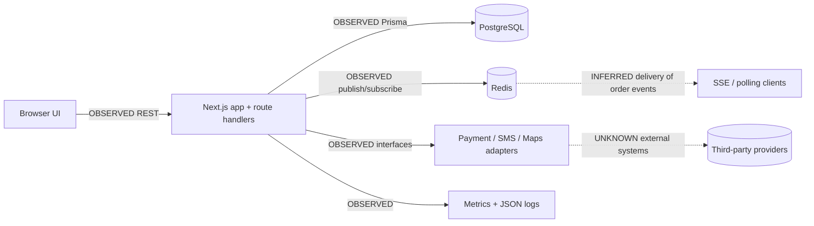
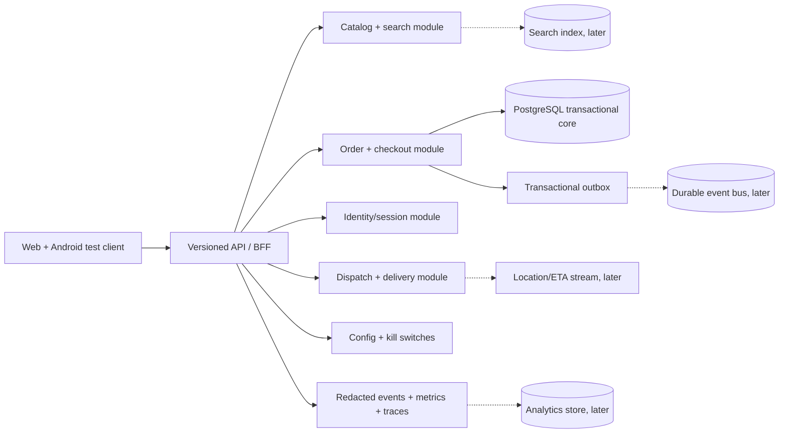

# Architecture comparison

**Date:** 2026-10-27  
**Comparison subject:** TableTrail versus the public baseline for Zomato's consumer food-ordering app and zomato.com.

## Reading the evidence

`OBSERVED` is direct source-tree or REA evidence. `PUBLIC-CLAIM` is from the cited public page. `INFERRED` is a design inference and includes an alternative explanation. `UNKNOWN` is not established by the available boundary. Confidence is H/M/L. Zomato backend details are deliberately not represented as observed.

## A. Capability map

| Capability | Zomato evidence (tag, confidence) | My equivalent (path or MISSING) | Gap |
|---|---|---|---|
| Search | PUBLIC-CLAIM H: Play listing describes search and filters; HAR OBSERVED H: supplied capture did not include a search/menu flow; exact implementation UNKNOWN H | `src/lib/domain.ts`, `src/app/page.tsx` (small in-process catalogue) | Need durable, indexed, geo-aware search when catalogue/traffic grows |
| Catalog/menu | PUBLIC-CLAIM H: Play listing describes restaurant menus and discovery; HAR UNKNOWN H: no menu flow captured | `prisma/schema.prisma` Restaurant/MenuItem; `src/app/restaurants/[id]/` | Basic catalog exists; no scale-oriented read model or content operations evidence |
| Cart | PUBLIC-CLAIM H: listing describes ordering; exact cart internals UNKNOWN | Local client cart in restaurant UI; order validation in `src/lib/orders.ts` | Need durable cart semantics and cross-device/session recovery if required |
| Checkout/payments | PUBLIC-CLAIM H: listing describes UPI, cards, wallets, COD and other modes; processor topology UNKNOWN | `src/lib/providers.ts` test/Razorpay interface; order route/idempotency | Payment capture, webhook lifecycle, refunds and reconciliation are incomplete |
| Order lifecycle | PUBLIC-CLAIM H: listing describes delivery and support; exact state machine UNKNOWN | `OrderStatus`, order routes, partner/delivery portals, `src/lib/orders.ts` | Core lifecycle exists; needs durable payment/refund/support and operational SLOs |
| Dispatch/logistics | PUBLIC-CLAIM H: listing describes delivery; exact dispatch algorithm UNKNOWN | Delivery queue/claim routes; `Order.deliveryPartnerId` | No dispatch optimizer, courier availability model or geo ETA contract |
| Live tracking | PUBLIC-CLAIM H: listing says real-time tracking; protocol UNKNOWN | Redis order events + SSE/polling; no location fields | Missing location/ETA stream, map UI and privacy/retention policy |
| Offers | PUBLIC-CLAIM H: listing describes discounts; offer engine UNKNOWN | MISSING (no offer/coupon model found) | Add only after payment/order ledger is reliable |
| Ratings/reviews | PUBLIC-CLAIM H: listing describes ratings/reviews | Restaurant display fields only; no review model/API | Missing review write/read/moderation and aggregation |
| Notifications | PUBLIC-CLAIM H: listing mentions support and order experience; Android OBSERVED H: Firebase Messaging classes; channels and actual use UNKNOWN | Provider interfaces and log/SMS adapters in `src/lib/providers.ts` | Missing durable notification preferences, inbox, push and delivery status |
| Identity/session | PUBLIC-CLAIM H: app is consumer account product; exact auth UNKNOWN | OTP challenges, sessions, HTTP-only session handling, roles | Need production SMS, abuse controls, rotation/logout and privacy lifecycle |
| Config/flags | UNKNOWN H: not established from public sources | MISSING (no flag/config SDK or model found) | Need kill switches and staged rollout before frequent production changes |
| Experimentation | UNKNOWN H: not established from public sources | MISSING | Do not copy until product has measurable traffic and experiment governance |
| Analytics | PUBLIC-CLAIM H: AWS says Zomato uses data insights for recommendations, waits and matching | Metrics/logging only; no event warehouse or product analytics model | Need event taxonomy and privacy-safe funnel metrics before ML |

## B. Rubric

| Dimension | Zomato public baseline | TableTrail evidence | Gap and right-sized interpretation |
|---|---|---|---|
| Client architecture | OBSERVED H (web): passive REA inspection found `/z-homepage/_astro/` scripts and `HomeLayout` naming. OBSERVED H (Android static): package uses Hilt/Dagger, Retrofit/OkHttp/Cronet, Firebase and image-loading libraries. PUBLIC-CLAIM H: Android case study used tracing, lazy SDK initialization and caching. | OBSERVED H: Next.js/React web app; no Android client | Zomato has a multi-client, SDK-heavy surface; first build a testable mobile/web contract and performance budget rather than copying toolkit choices |
| API and contracts | OBSERVED H (links only): restaurant page retained same-origin `/webroutes/getPage` candidates; HAR OBSERVED H: 85 records decoded but no search/menu flow; Android static evidence shows Retrofit service factories and per-tag clients; request paths/payloads/private APIs UNKNOWN | OBSERVED H: REST route handlers, Zod input validation, provider interfaces | Add explicit versioned schemas, error envelope and contract tests before service extraction |
| Service boundaries | PUBLIC-CLAIM H: AWS describes data sourced from various Zomato microservices; exact boundaries UNKNOWN | OBSERVED H: one deployable app and one Prisma schema | Modularize by domain inside the monolith first; extract only a hot/independently operated boundary |
| Data, state and caching | PUBLIC-CLAIM H: AWS describes Aurora, DynamoDB, S3/Iceberg, Trino/Druid data platform | OBSERVED H: PostgreSQL system of record; Redis pub/sub; static in-process discovery | Add read caching/search only when measurements justify it; retain Postgres for transactional core |
| Real-time and location | PUBLIC-CLAIM H: Play listing says real-time tracking; passive web inspection observed no WebSocket connection in its attach window; Android class-name search found no `WebSocket` top-level class; HAR OBSERVED H: no WebSocket or tracking flow was retained. These negatives are bounded and not proof of absence. | OBSERVED H: order status SSE/polling only; no coordinates in event model | Do not infer transport from bounded negative searches; add location as a privacy-bounded, separate contract and do not turn Redis pub/sub into a durable telemetry bus |
| Search/personalization/ML | PUBLIC-CLAIM H: AWS says data improves recommendations and wait/matching; model stack UNKNOWN | OBSERVED H: deterministic filter over four static restaurants | Establish event/funnel measurement and a relevance baseline before ML; search index later |
| Reliability and scale | PUBLIC-CLAIM H: Android case study reports performance optimization; backend resilience UNKNOWN | OBSERVED H: health checks, CI integration tests, process-local rate limiting, single app compose | Measure p95/p99 and concurrency; add distributed limits, pooling, load tests and backups before autoscaling |
| Observability | PUBLIC-CLAIM H: Android case study uses App Vitals/Perfetto; backend telemetry UNKNOWN | OBSERVED M: JSON logs, request IDs, Prometheus metrics, health routes | Add centralized logs/error tracking/traces with redaction and SLOs |
| Delivery (CI/CD, releases, flags) | UNKNOWN H: passive browser evidence shows client bundles but not release/flag operations | OBSERVED H: GitHub Actions verifies code/build; no deployment/flag workflow found | Add preview/staging, migrations/rollback discipline and kill switches |
| Security and privacy posture | OBSERVED H (static pattern only): manifest declares location, notification, biometric and network-related permissions; `RetrofitHelper` includes a named non-pinning Cronet reinitialization path. Runtime use, certificate policy and server posture UNKNOWN. | OBSERVED M: HTTP-only sessions, Zod validation, role checks; secrets are environment-based; production hardening incomplete | Threat-model payment/OTP/location and define retention/redaction; do not copy broad permissions or weaken transport controls |

## Current architecture diagram

Dashed edges indicate inferred or unverified runtime relationships. Solid edges are source-observed.

## Proposed target diagram

This is a design proposal, not an observation. Dashed edges are intentionally unproven or later-stage choices.

## Most important comparison conclusion

TableTrail is not missing “Zomato-scale microservices” as the first blocker. It is missing production-grade payment completion, measurement, contract discipline, distributed request controls, and the product capabilities that define a consumer delivery marketplace (offers, reviews, notifications, dispatch/location). Zomato-scale data and service machinery should be staged behind measured demand.

## Phase 3 design boundary

The implementation-ready design is intentionally for TableTrail only. See [gap-closure-report.md](./gap-closure-report.md), [clone-architecture-spec.md](./clone-architecture-spec.md) and the linked lifecycle, API, observability, scale and delivery documents. None of those proposed schemas or workflows are presented as Zomato's private API or backend architecture.
